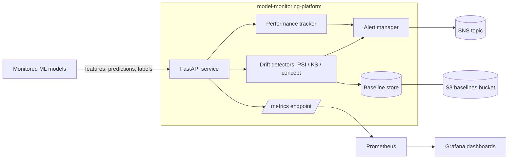

# Model Monitoring Platform

A FastAPI service for monitoring machine-learning models in production —
data drift, concept drift, rolling performance metrics, and alerting.

[](LICENSE)
[](https://github.com/abhisheksawant52/model-monitoring-platform/actions/workflows/ci.yml)
[](https://www.python.org/)
[](https://github.com/psf/black)
[](helm/model-monitoring)
[](terraform)

## Overview

Deployed models silently decay: the data they see in production drifts away
from their training distribution, the relationship between features and target
shifts (concept drift), and quality metrics erode. This platform continuously
compares live inference traffic against a versioned baseline and surfaces the
resulting signals as Prometheus metrics and alerts.

It is aimed at ML platform and MLOps engineers who need a lightweight,
self-hostable service to watch many models without adopting a heavyweight
vendor stack. The service is dependency-light (NumPy/pandas for statistics,
FastAPI for the API) and ships with the infrastructure to run it: a Helm chart
and Terraform for the supporting AWS resources.

The statistics implemented here (PSI, KS, rolling metrics) are the ones teams
reach for first. They are coherent and reasonable, and the detector interfaces
are designed so you can swap in more sophisticated tests without touching the
API or alerting layers.

## Architecture



Components:

- **FastAPI service** — health/readiness probes, on-demand drift checks, and a
  Prometheus metrics endpoint on port `8000`.
- **Drift detectors** — PSI and KS for data drift, error-rate degradation for
  concept drift.
- **Performance tracker** — rolling accuracy, precision, recall, latency p50/p95.
- **Alert manager** — threshold rules dispatched to pluggable channels.
- **Baseline store** — versioned reference profiles in S3.

## Features

- Data-drift detection via Population Stability Index and the two-sample KS
  statistic, with configurable warning/critical thresholds.
- Concept-drift detection based on rolling error-rate degradation against a
  baseline.
- Rolling model-performance metrics (accuracy, precision, recall, latency
  percentiles) over a bounded window.
- Threshold-rule alerting with a channel abstraction (log and AWS SNS built in).
- Versioned baseline management backed by S3.
- Prometheus-compatible metrics exposition and a Helm `ServiceMonitor`.
- Production-ready packaging: multi-stage non-root Docker image, Helm chart,
  and Terraform for ECR/S3/SNS.

## Tech Stack

Python 3.11+ · FastAPI · Uvicorn · Pydantic v2 · NumPy · pandas · pytest ·
ruff · black · Docker · Helm · Terraform (AWS) · GitHub Actions

## Getting Started

### Prerequisites

- Python 3.11 or newer
- `make` (optional, for convenience targets)
- Docker, Helm, and Terraform (only for the deployment assets)

### Install

```bash
python -m venv .venv && source .venv/bin/activate
make install            # pip install -e ".[dev]"
```

### Configure

```bash
cp .env.example .env    # then edit values as needed
```

### Run

```bash
uvicorn model_monitoring.main:app --reload
# or the installed console script:
model-monitoring
```

Then probe the service:

```bash
curl http://127.0.0.1:8000/health
curl -X POST http://127.0.0.1:8000/v1/drift/check \
  -H 'content-type: application/json' \
  -d '{"feature":"amount","reference":[1,2,3,4,5],"current":[10,11,12,13,14]}'
curl http://127.0.0.1:8000/metrics
```

## Project Structure

```
.
├── src/model_monitoring/        # FastAPI application package
│   ├── main.py                  # app factory + entrypoint
│   ├── config.py                # pydantic-settings configuration
│   ├── logging_config.py        # JSON logging
│   ├── drift.py                 # PSI / KS / concept-drift detectors
│   ├── performance.py           # rolling performance metrics
│   ├── alerting.py              # threshold rules + alert channels
│   ├── baseline.py              # reference dataset / baseline store
│   ├── metrics.py               # Prometheus-style exposition
│   └── api/                     # routers (health, monitoring)
├── tests/                       # pytest suite
├── helm/model-monitoring/       # Helm chart
├── terraform/                   # ECR + S3 + SNS (dev/prod, module)
├── architecture/architecture.md # architecture notes + diagram
├── docs/runbook.md              # operations runbook
├── Dockerfile                   # multi-stage, non-root image
└── .github/workflows/ci.yml     # CI pipeline
```

## Configuration

All settings are read from environment variables prefixed with `MM_` (see
[`.env.example`](.env.example)).

| Variable                  | Default                      | Description                                 |
| ------------------------- | ---------------------------- | ------------------------------------------- |
| `MM_PORT`                 | `8000`                       | HTTP port the service listens on.           |
| `MM_LOG_LEVEL`            | `INFO`                       | Logging verbosity.                          |
| `MM_PSI_WARN_THRESHOLD`   | `0.1`                        | PSI value that raises a warning.            |
| `MM_PSI_ALERT_THRESHOLD`  | `0.25`                       | PSI value that raises a critical alert.     |
| `MM_KS_PVALUE_THRESHOLD`  | `0.05`                       | KS p-value drift threshold.                 |
| `MM_MIN_ACCURACY`         | `0.80`                       | Minimum acceptable rolling accuracy.        |
| `MM_MAX_LATENCY_MS_P95`   | `250`                        | Maximum acceptable p95 latency (ms).        |
| `MM_ROLLING_WINDOW`       | `1000`                       | Size of the rolling metrics window.         |
| `MM_BASELINE_BUCKET`      | `model-monitoring-baselines` | S3 bucket for baseline profiles.            |
| `MM_AWS_REGION`           | `us-east-1`                  | AWS region.                                 |
| `MM_ALERT_SNS_TOPIC_ARN`  | _(empty)_                    | SNS topic ARN for alerts (optional).        |

## Deployment

### Helm

```bash
helm lint helm/model-monitoring
helm upgrade --install model-monitoring helm/model-monitoring \
  --set image.tag=0.1.0 \
  --set serviceMonitor.enabled=true
```

The chart provides deployment, service, ingress, HPA, service account, and a
Prometheus `ServiceMonitor` (port `8000`).

### Terraform

```bash
cd terraform
terraform init -backend=false
terraform validate
terraform plan -var-file=environments/dev/dev.tfvars
```

Provisions an ECR repository for the image, an S3 bucket for baselines, and an
optional SNS topic for alerts, with `dev` and `prod` environments.

## Contributing

Contributions are welcome — see [CONTRIBUTING.md](CONTRIBUTING.md) and our
[Code of Conduct](CODE_OF_CONDUCT.md).

## Security

Please report vulnerabilities as described in [SECURITY.md](SECURITY.md).

## License

Released under the [MIT License](LICENSE).
