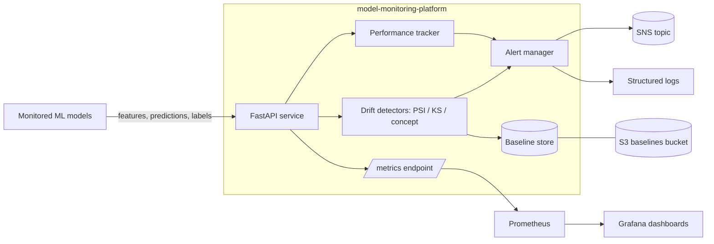

# Architecture — model-monitoring-platform

The platform ingests production inference traffic (features, predictions, and
delayed ground-truth labels), compares it against a versioned baseline, and
emits drift/performance signals as Prometheus metrics and alerts.

## Components

- **FastAPI service** — health/readiness probes, an on-demand drift-check
  endpoint, and a Prometheus metrics endpoint.
- **Drift detectors** (`drift.py`) — Population Stability Index and KS
  statistic for data drift; error-rate-degradation detector for concept drift.
- **Performance tracker** (`performance.py`) — rolling accuracy, precision,
  recall, and latency percentiles over a bounded window.
- **Alert manager** (`alerting.py`) — evaluates threshold rules and fans
  alerts out to pluggable channels (log, AWS SNS).
- **Baseline store** (`baseline.py`) — versioned reference profiles persisted
  to S3 as JSON.
- **Metrics registry** (`metrics.py`) — Prometheus text exposition.

## Data flow

1. Models (or a sidecar) POST features/predictions to the service.
2. The service loads the active baseline and computes drift statistics.
3. Metrics are updated and scraped by Prometheus; a ServiceMonitor wires this
   automatically in-cluster.
4. Threshold breaches raise alerts through the configured channels.
